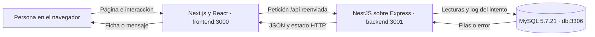

# 01 · Visión general

La función principal integrada es consultar una incidencia del CRM. Una persona escribe un código y su DNI, correo o código AMB; la aplicación busca una coincidencia, registra el intento y presenta el detalle. No modifica la incidencia al consultarla.

## Las piezas y su trabajo

| Pieza | Qué significa aquí | Dónde está |
| --- | --- | --- |
| Navegador | Muestra la pantalla y ejecuta la interacción de React | Ordenador de la persona que abre la web |
| Frontend | Aplicación que sirve las páginas y organiza su interfaz | [frontend/](../../frontend/) |
| Next.js 16 | Define las rutas, genera las páginas y reenvía `/api` | [next.config.ts](../../frontend/next.config.ts) y `frontend/src/app/` |
| React 19 | Construye los componentes y actualiza la vista al cambiar su estado | `frontend/src/components/` |
| Tailwind CSS 4 | Genera estilos a partir de las clases usadas en los componentes | [globals.css](../../frontend/src/app/globals.css) y [postcss.config.mjs](../../frontend/postcss.config.mjs) |
| Backend | Recibe peticiones, valida datos y aplica las reglas de consulta | [backend/](../../backend/) |
| NestJS 11 | Organiza la API en módulos, controladores y servicios | [app.module.ts](../../backend/src/app.module.ts) |
| Express | Adaptador HTTP usado por NestJS para atender peticiones | Configurado mediante `@nestjs/platform-express` |
| Node.js 24 | Ejecuta los servidores de Next.js y NestJS | Imágenes de ambos servicios en Docker |
| MySQL 5.7.21 | Conserva la copia local de los datos del CRM y los logs | Servicio `db` de [Compose](../../docker-compose.yml) |
| Docker Compose | Arranca y conecta los servicios locales | [docker-compose.yml](../../docker-compose.yml) |

TypeScript se usa en ambas aplicaciones para comprobar tipos durante el desarrollo. Los archivos `.ts` contienen lógica y los `.tsx` permiten además escribir JSX, la sintaxis con aspecto de HTML que React utiliza para describir la interfaz. Los tipos no validan por sí solos los datos recibidos por HTTP.

El navegador conoce la dirección de la web, por ejemplo `http://localhost:3000`. El backend conoce la conexión de MySQL. El navegador no recibe esa conexión ni ejecuta SQL.

## Qué ocurre al consultar

1. Next.js entrega la página de inicio con dos campos.
2. React recoge sus valores y hace un POST a `/api/incidencias/consulta`.
3. Next.js reenvía esa petición al backend; esta regla se denomina *rewrite* o reescritura.
4. NestJS comprueba el cuerpo recibido y busca la pareja de datos en MySQL.
5. Si hay coincidencia, añade el nombre de línea y los estados de los expedientes relacionados.
6. El backend espera a guardar el log del intento antes de responder.
7. React conserva el resultado en memoria y muestra la página de detalle o el mensaje de ausencia.

El [capítulo 04](04-api-y-consulta.md) sigue estos pasos archivo por archivo, incluyendo los errores.

## Pequeño vocabulario

| Término | Explicación aplicada al proyecto |
| --- | --- |
| Ruta de página | Dirección que muestra una pantalla, como `/incidencias/resultado` |
| Endpoint | Combinación de método y ruta de una API, como `POST /api/incidencias/consulta` |
| HTTP | Protocolo con el que el navegador y los servidores intercambian peticiones y respuestas |
| JSON | Formato de texto para enviar objetos y listas; por ejemplo `{ "status": "ok" }` |
| Componente | Función de React que describe una parte de la interfaz |
| Estado de React | Datos temporales que provocan una actualización visual cuando cambian |
| DTO | Clase que describe y valida lo que puede entrar en una operación del backend |
| Repositorio | Clase donde se concentra el acceso a datos de un dominio |
| Pool | Conjunto limitado de conexiones a MySQL que se reutilizan |
| Log de consulta | Registro persistido de un intento de búsqueda, válido o no |

## Qué está integrado y qué queda por hacer

En esta versión hay consulta individual, ficha con 21 campos visibles, nombre de línea, estados de expedientes y logs de los intentos. También existe `/incidencias`, una pantalla de demostración con datos escritos en el código; no es un listado del CRM.

La coincidencia de código e identificador es el criterio de acceso provisional de la consulta. No hay un inicio de sesión general del CRM ni una pantalla de administración de logs. El modo compilado tampoco configura una conexión a producción. La [nueva queja](08-formulario-queja-pendiente.md) sigue en otra rama y todavía no guarda reclamaciones.

[Siguiente: frontend →](02-frontend.md)
