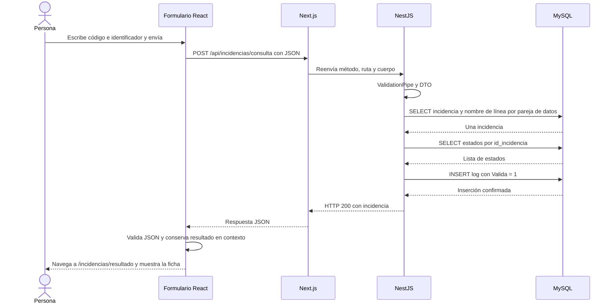

# 04 · API y recorrido de una consulta

La API es el acuerdo entre el frontend y el backend: define qué puede pedirse, con qué datos y qué significa cada respuesta. Una página y un endpoint pueden tener direcciones parecidas, pero cumplen funciones distintas.

## Direcciones, métodos y JSON

`GET /incidencias/resultado` solicita una pantalla a Next.js. `POST /api/incidencias/consulta` solicita una búsqueda a NestJS y recibe JSON. Abrir la URL del segundo en la barra del navegador hace un GET, por lo que no ejecuta el POST de consulta.

Un **GET** solicita un recurso sin cuerpo en estos endpoints. Un **POST** envía un cuerpo a una operación concreta. En esta aplicación, un POST de consulta lee la incidencia y escribe su log: el método por sí solo no describe todos los efectos internos.

El cuerpo de consulta tiene esta forma sintética:

```json
{
  "codigoIncidencia": "00417",
  "identificador": "prueba@example.invalid"
}
```

`Content-Type: application/json` indica al servidor cómo interpretar ese cuerpo. El frontend usa `JSON.stringify` para convertir el objeto JavaScript en texto JSON; `response.json()` hace el recorrido inverso con la respuesta.

Se usa el cuerpo para que código e identificador no aparezcan como parámetros de URL. Eso no cifra la petición ni sustituye HTTPS. El criterio de acceso actual es la coincidencia de los dos datos; no existe un token de inicio de sesión para este flujo.

## Endpoints integrados en esta versión

Las direcciones de esta tabla son las que se pueden solicitar al mismo origen de la web, con puerto predeterminado 3000.

| Método y ruta | Quién lo atiende | Resultado |
| --- | --- | --- |
| `GET /health` | Next.js | Estado de vida del servidor web |
| `GET /api` | `AppController` | Nombre, versión y ruta de salud de la API |
| `GET /api/health` | `HealthController` | Estado del proceso NestJS; no comprueba SQL |
| `POST /api/incidencias/consulta` | `IncidenciasController` | Incidencia y log del intento, o error |
| `GET /api/docs` | Swagger, si está habilitado | Documentación interactiva de la API |

Por ejemplo, `/api/health` devuelve `status`, `service`, `timestamp`, `uptimeSeconds` y `database: "not-checked"`. Este último valor explica que una respuesta de salud correcta no garantiza una búsqueda correcta en MySQL. `/health` pertenece a Next.js y no pasa por NestJS.

No hay un endpoint integrado de listado del CRM, de consulta de logs ni de creación de quejas. `GET /api/lineas` corresponde al [trabajo de quejas pendiente](08-formulario-queja-pendiente.md), no a esta base de `develop`.

## Qué hace la reescritura de Next.js

En [next.config.ts](../../frontend/next.config.ts), `/api/:path*` se reenvía a `http://backend:3001/api/:path*`. Así, el navegador llama a su propio origen y Next.js contacta con el servicio `backend` dentro de Docker.

Por ejemplo, `http://localhost:3000/api/health` llega internamente a `http://backend:3001/api/health`. No es una redirección que obligue al navegador a resolver el nombre `backend`. El cuerpo y el método de la consulta se reenvían también. Para este flujo no hace falta que el frontend llame al puerto 3001 ni que NestJS habilite CORS.

## Recorrido completo de una coincidencia

El diagrama representa un cuerpo válido, una incidencia encontrada y un log confirmado:



Puedes seguirlo abriendo estos archivos, en orden:

1. [consulta-incidencia-form.tsx](../../frontend/src/components/consulta-incidencia-form.tsx): evento `consultar`, validación local y `fetch`.
2. [next.config.ts](../../frontend/next.config.ts): regla `rewrites`.
3. [main.ts](../../backend/src/main.ts) y [consultar-incidencia.dto.ts](../../backend/src/incidencias/consultar-incidencia.dto.ts): prefijo y validación global.
4. [incidencias.controller.ts](../../backend/src/incidencias/incidencias.controller.ts): ruta y llamada al servicio.
5. [incidencias.service.ts](../../backend/src/incidencias/incidencias.service.ts): instante de inicio y coordinación del intento.
6. [incidencias.repository.ts](../../backend/src/incidencias/incidencias.repository.ts): SELECT de incidencia, línea y estados.
7. [logs-consultas.repository.ts](../../backend/src/incidencias/logs-consultas.repository.ts): INSERT del log.
8. [lib/incidencias.ts](../../frontend/src/lib/incidencias.ts) y [consulta-incidencia-context.tsx](../../frontend/src/components/consulta-incidencia-context.tsx): validación y memoria compartida.
9. [resultado-incidencia.tsx](../../frontend/src/components/resultado-incidencia.tsx): presentación.

## Respuesta y errores

La respuesta 200 contiene `{ "incidencia": { ... } }`. Dentro hay 28 columnas de `crm_incidencia`, `nom_linea_tusgsal` y `estados_expedientes`: 30 propiedades. Este fragmento explica la forma de los campos añadidos; **no es la respuesta completa**:

```json
{
  "incidencia": {
    "id": 417,
    "m_linea": 7,
    "nom_linea_tusgsal": "B1",
    "estados_expedientes": ["estado de ejemplo", null]
  }
}
```

| Situación | HTTP | Efecto sobre logs | Qué hace el frontend |
| --- | --- | --- | --- |
| Cuerpo inválido o propiedades adicionales | 400 | No se ejecuta el servicio ni se escribe log | Permanece en el formulario y pide revisar los datos |
| Incidencia encontrada y log confirmado | 200 | `Valida = 1` | Conserva el resultado y muestra la ficha |
| Sin coincidencia y log confirmado | 404 | `Valida = 0` | Navega al resultado y muestra «No se han encontrado los datos.» |
| Fallo al leer incidencia o expedientes | 503 | Intenta registrar `Valida = 0` | Muestra un error recuperable en el formulario |
| Fallo al confirmar el log | 503 | La escritura no pudo confirmarse | No recibe la incidencia; permanece en el formulario |
| Fallo de red, timeout o JSON inesperado en el navegador | Puede no recibirse una respuesta utilizable | La situación del servidor no puede deducirse desde ese fallo | Muestra un error y permite reintentar |

La última fila es importante: dejar de esperar en el navegador no cancela necesariamente el trabajo en MySQL. Puede haberse guardado el log aunque el cliente no haya recibido la respuesta. Reintentar genera una petición nueva y puede generar otro log; no hay deduplicación.

El 404 de la consulta significa ausencia de coincidencia **después** de validar el cuerpo. Un 404 de una ruta inexistente es otra situación: la operación de consulta no llega a ejecutarse.

Swagger permite consultar las descripciones y probar endpoints en desarrollo. Ejecutar allí el POST de consulta tiene los mismos efectos de registro que ejecutarlo desde el formulario. El contrato detallado está en [api.md](../api.md).

[← Backend](03-backend.md) · [Siguiente: base de datos y logs →](05-base-de-datos-y-logs.md)
