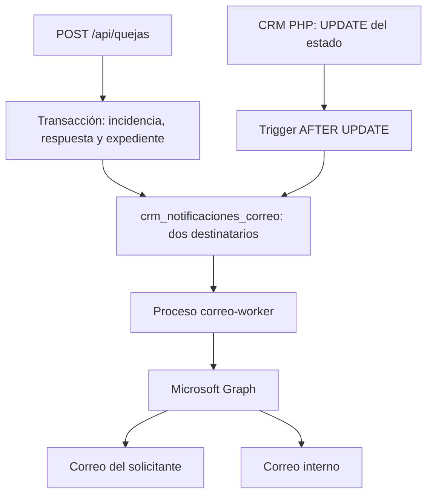

# Avisos por correo de las quejas

El alta web y los cambios de `crm_expediente.estado` generan dos avisos independientes: uno al correo de la queja y otro al destinatario interno configurado. El proveedor elegido es Microsoft 365 mediante Microsoft Graph. El envío está **desactivado por defecto** hasta configurar la aplicación de Microsoft 365.

## Recorrido de un aviso



En el alta, los avisos se insertan antes del COMMIT de la queja. En un cambio de estado, el trigger los inserta dentro de la misma transacción del UPDATE. Si se revierte la operación, también desaparecen sus avisos. Si falla la escritura de la cola, falla el alta o el cambio de estado: este comportamiento evita confirmar cambios sin registrar su notificación.

El trigger **no hace HTTP** ni envía correo. Un proceso NestJS separado revisa la cola cada cinco segundos, reserva un aviso, libera la transacción y llama al proveedor. No necesita modificar el CRM PHP ni abrir un endpoint público de envío. Graph devuelve 202 cuando acepta el mensaje; esto no demuestra la entrega al buzón. [Referencia de sendMail](https://learn.microsoft.com/en-us/graph/api/user-sendmail?view=graph-rest-1.0).

Los correos incluyen código de incidencia, confirmación de alta o estado anterior/actual, y un enlace general de consulta si se configura. No incluyen nombre, DNI, dirección ni texto de reclamación. Se realizan envíos individuales: el solicitante y el destinatario interno no aparecen juntos en Para/CC. El usuario recibe el diseño de `backend/src/notificaciones/plantillas/usuario.html`, editable según [plantilla-correo-usuario.md](plantilla-correo-usuario.md); el aviso interno conserva texto plano. SMTP incluye también una alternativa de texto para el usuario.

## Configuración temporal y cambio de direcciones

El `.env` local contiene temporalmente `jcaballero@tusgsal.es` tanto como remitente como destinatario interno, según lo solicitado. `.env` no se versiona. `.env.example` conserva direcciones ficticias.

| Variable | Uso |
| --- | --- |
| `MAIL_FROM` | Buzón remitente autorizado en Microsoft 365; usar su identificador principal, no `Nombre <correo>` |
| `NOTIFICATIONS_INTERNAL_TO` | Dirección que recibe la copia interna |
| `NOTIFICATIONS_ENABLED` | `false` conserva los avisos sin enviar; `true` activa su consumo |
| `MAIL_TRANSPORT` | `microsoft365`, opción elegida; `smtp` como alternativa explícita |
| `MS365_TENANT_ID` | Id del directorio de Microsoft Entra |
| `MS365_CLIENT_ID` | Id de la aplicación de Entra |
| `MS365_CLIENT_SECRET` | Valor del secreto de aplicación, no su id ni la contraseña de Outlook |
| `NOTIFICATIONS_CONSULTATION_URL` | URL general HTTP(S), sin credenciales, parámetros ni fragmento; opcional |
| `NOTIFICATIONS_INTERVAL_MS` | Intervalo entre lotes, 5000 ms por defecto; 100–60000 |
| `NOTIFICATIONS_MAX_ATTEMPTS` | Máximo de intentos por destinatario, 5 por defecto; 1–10 |

Para cambiar los correos, edita `MAIL_FROM` y/o `NOTIFICATIONS_INTERNAL_TO` en `.env` y recrea el proceso:

```bash
docker compose --profile notificaciones up -d --no-deps --force-recreate correo-worker
```

Un `restart` no relee `.env`. Si cambia el remitente, el administrador debe autorizar ese otro buzón en Microsoft 365. El correo del solicitante se captura al generar el aviso; el interno se fija al reservarlo por primera vez. Cambiar la dirección interna afecta a avisos aún no reservados; los reintentos conservan su dirección previa.

## Activar Microsoft 365

1. Un administrador registra una aplicación propia del proyecto en Microsoft Entra y obtiene tenant id y client id. Crea una credencial de aplicación con caducidad controlada; esta versión admite secreto de cliente.
2. Autoriza el envío de aplicación al buzón remitente. Para limitar el acceso a ese buzón, configurar **Application RBAC de Exchange Online**, con el rol `Application Mail.Send` y su ámbito de recursos. El administrador debe comprobar el ámbito efectivo antes de activar el servicio. Los permisos amplios otorgados en Entra y los de RBAC son independientes y se suman: añadir RBAC no recorta por sí solo una concesión global previa. [Configuración oficial de Application RBAC](https://learn.microsoft.com/en-us/exchange/permissions-exo/application-rbac).
3. Introduce `MS365_TENANT_ID`, `MS365_CLIENT_ID` y el **valor** de `MS365_CLIENT_SECRET` únicamente en `.env` o en el gestor de secretos del entorno. No los envíes por chat ni los incluyas en Git. El proceso solicita tokens con `client_credentials` y el ámbito `https://graph.microsoft.com/.default`; no inicia sesión interactiva con el buzón. [Flujo oficial de credenciales de aplicación](https://learn.microsoft.com/en-us/entra/identity-platform/v2-oauth2-client-creds-grant-flow).
4. Verifica que la cola no contiene avisos de pruebas ni pendientes que no deban enviarse: al activar, se procesan también los avisos acumulados con el envío desactivado. No se hace una carga automática de cambios históricos anteriores a instalar el trigger.
5. Configura la URL de consulta y las direcciones, cambia `NOTIFICATIONS_ENABLED=true` y arranca/recrea el worker. La primera activación requiere su imagen:

```bash
docker compose --profile notificaciones up -d --build correo-worker
docker compose logs --tail 30 correo-worker
```

La configuración incompleta impide arrancar el emisor; la API puede seguir registrando quejas y avisos sin credenciales de Microsoft. En esta implementación no se ha iniciado sesión ni configurado permisos en el tenant: ese paso corresponde al administrador. No se ha enviado ningún correo externo durante las pruebas.

## Instalación de la cola y el trigger

La instalación es manual y requiere una copia de datos autorizada. No se ejecutan SQL al arrancar, ni se cambia el esquema de referencia. Sigue [la estructura y precondiciones de datos](base-de-datos/notificaciones-correo.md). El orden es:

1. Revisar/aplicar `backend/sql/002-crear-notificaciones-correo.sql`.
2. Revisar/aplicar `backend/sql/003-trigger-notificaciones-estado.sql`.
3. Arrancar la API actualizada; el alta ya necesita poder insertar en la cola aunque el envío esté desactivado.
4. Compilar el backend e iniciar el perfil `notificaciones` cuando se quiera mantener el consumidor en ejecución.

No se envían avisos de alta por inserciones realizadas desde otros programas: ese evento se registra en `QuejasRepository`. Los cambios posteriores de estado sí quedan cubiertos por el trigger, con independencia de que procedan del CRM PHP o de otra conexión a esa base.

## Reintentos y operación

Cada destinatario tiene su propia fila y contador. Una reserva dura 120 segundos y usa un token distinto; el proveedor se llama fuera de la transacción. Un proceso interrumpido deja una reserva recuperable. Se conserva el orden por incidencia y tipo de destinatario: un estado posterior espera al aviso anterior pendiente de ese destinatario. Un fallo permanente o agotado permite continuar los siguientes avisos.

Los fallos temporales esperan 60, 120, 240… segundos, con tope de una hora para el cálculo exponencial. Se respeta una espera `Retry-After` mayor del proveedor, limitada a un día. Los fallos permanentes y los que alcanzan el máximo quedan `fallido`; no hay reenvío administrativo automático. Un correo histórico ausente o inválido falla para el solicitante sin impedir el aviso interno. Los errores registrados son códigos seguros, sin tokens, correos ni respuestas externas.

`enviado` significa aceptado por Graph/SMTP, no leído ni entregado. Puede haber duplicados si el proveedor acepta un mensaje y el proceso se interrumpe antes de guardar esa aceptación. El identificador estable ayuda a rastrearlos, pero no garantiza deduplicación en Microsoft 365. No se promete entrega exactamente una vez.

Consulta agregada de seguimiento, ejecutada por un administrador autorizado:

```sql
SELECT estado_envio, COUNT(*) AS total
FROM crm_notificaciones_correo
GROUP BY estado_envio;
```

Para pausar únicamente el consumidor:

```bash
docker compose stop correo-worker
```

Los eventos siguen registrándose. No se borran avisos ni se reescriben estados del CRM. `/api/health` continúa siendo liveness: no certifica disponibilidad de Graph ni progreso de la cola. Están pendientes definir conservación, alertas y procedimiento administrativo para avisos fallidos antes de operar fuera del entorno local.

## Código y alternativa SMTP

`notificaciones.repository.ts` administra la cola; `correo.service.ts` presenta el mensaje y usa Graph o Nodemailer; `plantilla-correo.ts` lee el HTML del solicitante en cada envío, sustituye sus variables con escape y valida bloques opcionales; `notificaciones.worker.ts` procesa lotes sin solaparlos; `worker.ts` inicia el proceso sin puerto HTTP y cierra recursos tras el envío activo. La API solo importa el repositorio y no inicia otro consumidor.

SMTP requiere `MAIL_TRANSPORT=smtp`, `SMTP_HOST`, `SMTP_PORT` (587), `SMTP_SECURE` (false para STARTTLS), `SMTP_REQUIRE_TLS` (true), `SMTP_USER` y `SMTP_PASSWORD`, según el servidor autorizado. No se presupone que Microsoft 365 permita contraseña SMTP. En las pruebas se utiliza exclusivamente un SMTP sintético sobre loopback, sin TLS dentro de esa prueba; la configuración real conserva TLS obligatorio. Véase [Nodemailer SMTP](https://nodemailer.com/smtp).

En desarrollo el worker comparte `dist` y `node_modules` en lectura y no ejecuta `npm ci`. Hay que reiniciarlo después de recompilar cambios de código. Antes de instalar dependencias, detener **backend y correo-worker**: comparten el mismo volumen. Consulta [Docker](docker.md).
