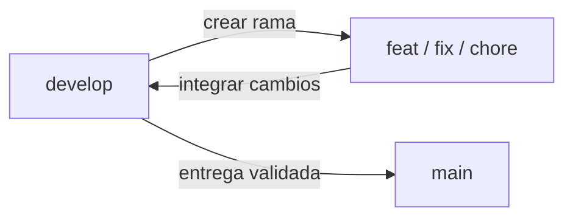

# Flujo de ramas

`main` representa la versión estable destinada a producción. `develop` reúne el trabajo en curso. Cada funcionalidad, corrección o sección se trabaja en una rama propia creada desde `develop`.

| Rama | Uso | Destino de integración |
| --- | --- | --- |
| `main` | Referencia estable para las entregas | Producción, mediante el proceso de despliegue que se configure |
| `develop` | Integración y validación del desarrollo | `main`, al preparar una entrega validada |
| `feat/<funcionalidad>` | Funcionalidad o sección, por ejemplo `feat/gestion-usuarios` | `develop` |
| `fix/<correccion>` | Corrección de un problema concreto | `develop` |
| `chore/<tarea>` | Documentación, configuración o mantenimiento | `develop` |



## Empezar una tarea

Con el directorio de trabajo limpio, actualizar `develop` y crear una rama descriptiva:

```sh
git switch develop
git pull --ff-only origin develop
git switch -c feat/nombre-funcionalidad
```

Después de desarrollar, revisar los cambios, ejecutar las comprobaciones aplicables de [docker.md](docker.md) y crear los commits de la tarea. Para publicar la rama por primera vez:

```sh
git push -u origin feat/nombre-funcionalidad
```

El seguimiento remoto de cada rama apunta a su rama homónima en `origin`. Crear una rama desde `develop` significa tomar sus commits como punto de partida.

## Integrar una tarea

La solicitud de integración de una rama de tarea debe tener `develop` como destino. Si la integración se realiza localmente:

```sh
git switch develop
git pull --ff-only origin develop
git merge --no-ff feat/nombre-funcionalidad
```

Resolver los conflictos y comprobar el resultado antes de publicarlo:

```sh
git push origin develop
```

Usar un merge con commit permite identificar cada integración en el historial. Las tareas siguientes se crean desde la versión actualizada de `develop`.

## Preparar una entrega

Cuando el conjunto de cambios esté listo, validar `develop` con las comprobaciones de [docker.md](docker.md), incluidas la construcción de las imágenes compiladas y las pruebas de humo para una entrega. Integrar entonces `develop` en `main` mediante una solicitud de integración o un merge revisado.

El despliegue toma la versión elegida de `main`. Este flujo define la organización de Git; las protecciones de ramas y el despliegue automático requieren configuración adicional en el alojamiento del repositorio.

## Adopción del flujo

El 28 de octubre de 2026 se inicia `develop` con el trabajo de `feat/consulta-incidencias-ficha-resultados`. Se conserva esa rama publicada y su historial. La documentación del flujo se incorpora mediante `chore/flujo-de-ramas`; la promoción de la consulta de incidencias a `main` queda para una entrega posterior.
